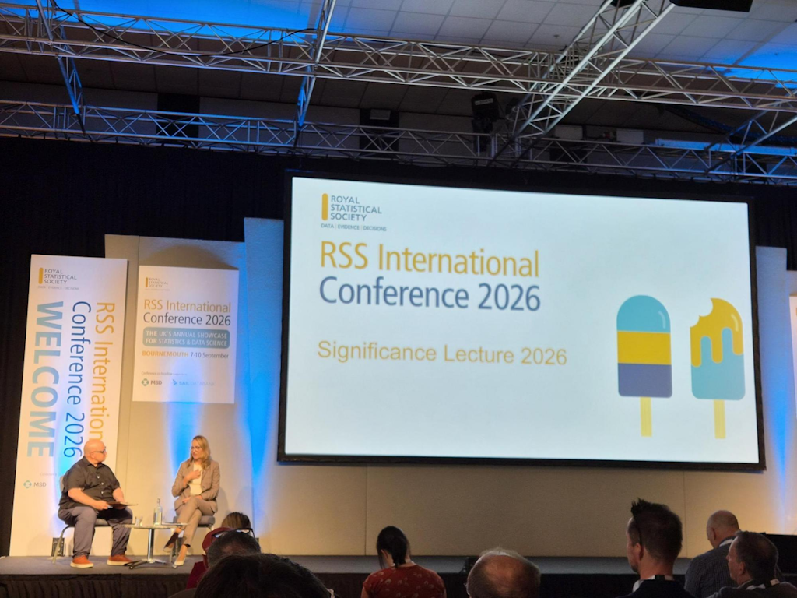

The annual Royal Statistical Society [International Conference](https://rss.org.uk/training-events/conference2026/) is one of the leading conferences for both basic and applied statistics. Although not limited to medical statistics, this is always a major topic stream. This year, Dominik presented an abstract regarding the estimation of clinical net benefit from published prognostic studies. He also made some new contacts for future collaborations. They also, as usual, had some funny buttons with stat-jokes!

