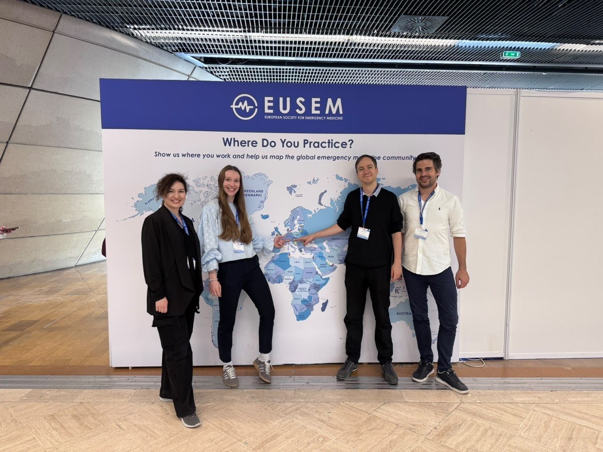

The European Emergency Medicine Congress, held by [EUSEM](https://eusem.org/), is one of the largest and most important conferences in emergency medicine worldwide. We participate each year, and this year Karina, Larissa and Roland presented their research. Dominik, in his role as an editorial board member of the [European Journal of Emergency Medicine](https://www.ovid.com/jnls/euro-emergencymed), participated as well.

## Presentation of recent study results

* Karina presented a poster of the results of the HEART-score review [(for which she was very recently awarded)](/2026/09/04/notfallsymposium/).
* Larissa gave an oral presentation on preliminary results of our evaluation of the Treetop-Clinical Decision Support System, used for the chest pain-pathway at our ED.
* Roland gave a talk on preliminary results of the third chapter of his PhD-thesis: Middle-to-Long-term Effects of a GP-run Walk-in Clinic On Emergency Department Utilisation

All three did an excellent job!

We were also very pleased to see the international *PRESC1SE-study*, comparing 1h- and 3h-algorithms for Troponins being mentioned as one of the *most important trials in emergency medicine* of the year. Our group served as the national study centre for the trial, and Larissa and Maxi F. worked very hard on this project over multiple years. Well done!

