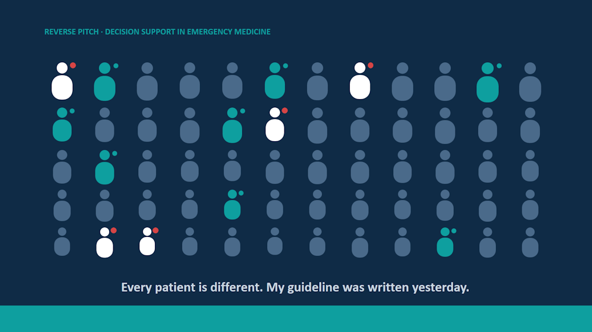

Under the title "Real Stories, Real Impact" the [event](https://www.meduniwien.ac.at/web/ueber-uns/events/2026/real-stories-real-impact-meduni-vienna-spin-offs/) brought together founders, funders and researchers.

Besides presentation by the people behind successful spinoffs from MedUni and founding agencies, clinicians and researchers were also invited to present currently unsolved challenges.

Dominik talked about how a living, personalised knowledge graph would improve decision support in emergency medicine. Besides many aspiring founders, Dominik also made useful contacts to other researchers at our university working on similar topics, and explored potential collaborations.

