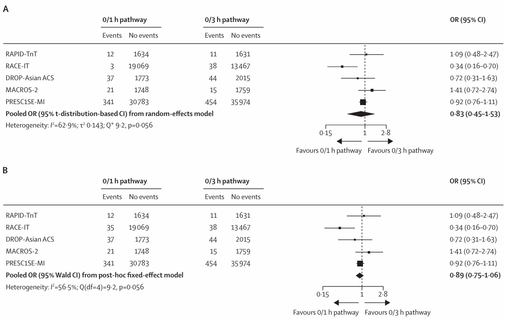

We are very happy that not only one, but two publications out of our participation in the international PRESC1SE-collaboration have now been published in the Lancet.

## Safe decision making for acute chest pain

Quickly and reliably distinguishing between patients suffering from acute myocardial infarction and those with less dangerous causes of acute chestt pain is a major challenge in emergency medicine. Diagnostic pathways, including repeated lab tests, shape this process.

The PRESC1SE-collaboration, which we are part of, investigated a faster (lab-tests at  0 and 1h) vs. the standard slower (0 and 3hrs) pathway in **more than 67,000 patients from 19 hospitals in ten countries**. We found that the faster pathway was non-inferior to the slower pathway. Interestingly, however, just because the diagnostic pathway was faster, this did not automatically lead to faster discharge from the ED! Read the [full paper](https://doi.org/10.1016/S0140-6736(26)01654-5) in the Lancet for more details!

In a [second paper](https://doi.org/10.1016/S0140-6736(26)01767-8), we performed an **individual patient data (IPD)-meta analysis**, pooling the PRESC1SE-data with further studies, totalling **110,000 patients across 46 hospitals**. We could confirm the previous findings, and also found that organisational differences between the various centres, in particular, have a significant influence on the time taken until discharge.

Those two publications were alo featured at the [MedUni website](https://www.meduniwien.ac.at/web/en/about-us/news/2026/news-in-november-2026/acute-heart-attack-rapid-diagnostic-algorithm-just-as-reliable-as-the-longer-diagnostic-pathway/).

## Hard work pays off, and what's coming next

We are super grateful to Larissa and Maxi N., who worked on this collaboration for more than five years, and of course the colleagues from Basel who invited us to participate in this great endeavour in the first place. Special congratulations go to Larissa who, as an early-stage researcher, now boasts two Lancet co-authorships on her CV! 

But of course the story does not end here. The PRESC1SE-collaboration is currently working on follow-up projects, and were are very happy to already provide suggestions for diagnostic & prognostic research using the collected data. Stay tuned for further news! 📊

