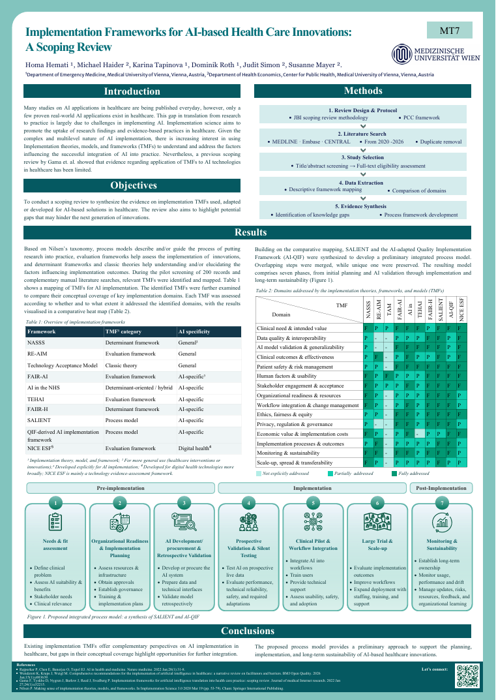

The [ISPOR Europe conference](https://www.ispor.org/conferences-education/conferences/past-conferences/ispor-europe-2026) is Europe's leading conference for health economics and outcome research, and this year it took place in Vienna. Homa took the chance to present a poster outlining the first chapter of her PhD-thesis: A scoping review investigating implementation frameworks, and how they can be used for AI-based healthcare innovations. For this project Homa is collaborating with Michael, a PhD-student supervised from the Department of Health Economics.

Besides her own presentation, Homa also participated in numerous other sessions a took a lot of inspiration from the conference.

